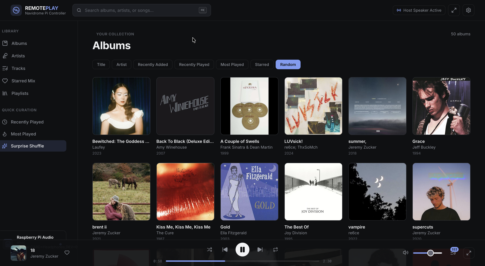

# RemotePlay

A lightweight Navidrome/Subsonic music controller designed to run on a Raspberry Pi.



Control music over the network via HTTP webpage, audio ALWAYS comes out of the server, not the web browser.

> [!IMPORTANT]
> This app is 100% vibe-coded, the code has undergone manual review.
> This is intended as a side-hobby project to allow my Raspberry Pi to act as a music client, not a production audio server intended for deployment.

## Configure

Copy `.env.example` to `.env.local` and fill in the Navidrome URL, username, and password. RemotePlay uses the Subsonic token authentication flow described by Navidrome.

## Run

```bash
npm install
npm run dev -- --hostname 0.0.0.0
```

Open `http://<raspberry-pi-ip>:3000` in the Pi's browser. For production, use `npm run build && npm start -- --hostname 0.0.0.0` and keep the process alive with your preferred service manager.

## Deploy on Linux

The production app can run as a `systemd` service and start automatically at boot.

Install Node.js, npm, and the server-side audio player:

```bash
sudo apt update
sudo apt install -y acl git mpv nodejs npm
```

Next.js 16 requires Node.js 20 or newer. Install the project under `/opt/remoteplay`, then configure and build it:

```bash
sudo mkdir -p /opt/remoteplay
sudo chown "$USER":"$USER" /opt/remoteplay
git clone <repository-url> /opt/remoteplay
cd /opt/remoteplay
npm ci
cp .env.example .env.local
```

Edit `.env.local` with the Navidrome connection details:

```env
NAVIDROME_URL=http://your-navidrome-host:4533
NAVIDROME_USER=your-username
NAVIDROME_PASSWORD=your-password
```

Build the production app:

```bash
npm run build
```

### Option 1: System service with ALSA

Use a system service for a headless Raspberry Pi or other machine using a directly attached ALSA device such as HDMI, USB audio, or the headphone jack. Create a dedicated service user and give it access to the audio device:

```bash
sudo useradd --system --home /opt/remoteplay --shell /usr/sbin/nologin remoteplay
sudo usermod -aG audio remoteplay
sudo chown -R "$USER":"$USER" /opt/remoteplay
sudo chmod 755 /opt/remoteplay
sudo chmod 600 /opt/remoteplay/.env.local
sudo setfacl -R -m u:remoteplay:rX /opt/remoteplay
sudo setfacl -m u:remoteplay:r /opt/remoteplay/.env.local
```

Create `/etc/systemd/system/remoteplay.service`:

```ini
[Unit]
Description=RemotePlay Navidrome controller
After=network-online.target
Wants=network-online.target

[Service]
Type=simple
User=remoteplay
Group=remoteplay
WorkingDirectory=/opt/remoteplay
CacheDirectory=remoteplay
Environment=NODE_ENV=production
Environment=PORT=3000
Environment=HOSTNAME=0.0.0.0
ExecStart=/usr/bin/npm start -- --hostname 0.0.0.0
Restart=on-failure
RestartSec=5

[Install]
WantedBy=multi-user.target
```

Enable and start the service:

```bash
sudo systemctl daemon-reload
sudo systemctl enable --now remoteplay
sudo systemctl status remoteplay
```

RemotePlay is then available at `http://<linux-host-ip>:3000`. View runtime logs with:

```bash
sudo journalctl -u remoteplay -f
```

To update an existing installation:

```bash
cd /opt/remoteplay
git pull
npm ci
npm run build
sudo systemctl restart remoteplay
```

Keep the project owned by the user who performs updates. The service user only needs read and execute access to the project. If the installation was previously changed to `remoteplay` ownership, restore it before updating:

```bash
sudo apt update
sudo apt install -y acl
sudo chown -R pi:pi /opt/remoteplay
sudo setfacl -R -m u:remoteplay:rX /opt/remoteplay
sudo setfacl -m u:remoteplay:r /opt/remoteplay/.env.local
```

### Option 2: User service with PulseAudio or PipeWire

Use a user service when audio is managed by a logged-in desktop user's PulseAudio or PipeWire session. Run the setup below as that audio user, replacing `your-user` with the Linux username:

```bash
sudo loginctl enable-linger your-user
mkdir -p /home/your-user/.config/systemd/user
```

Create `/home/your-user/.config/systemd/user/remoteplay.service`:

```ini
[Unit]
Description=RemotePlay Navidrome controller
After=network-online.target

[Service]
Type=simple
WorkingDirectory=/opt/remoteplay
CacheDirectory=remoteplay
Environment=NODE_ENV=production
Environment=PORT=3000
Environment=HOSTNAME=0.0.0.0
ExecStart=/usr/bin/npm start -- --hostname 0.0.0.0
Restart=on-failure
RestartSec=5

[Install]
WantedBy=default.target
```

Make sure the user service account can read the project and `.env.local`, then enable it:

```bash
sudo chown -R your-user:your-user /opt/remoteplay
systemctl --user daemon-reload
systemctl --user enable --now remoteplay
systemctl --user status remoteplay
```

View logs with:

```bash
journalctl --user -u remoteplay -f
```

Do not run both service options at the same time because they would both try to use port 3000.

## Cover art cache

Album art is fetched from Navidrome once and then cached on disk, so repeat views are
served locally and Navidrome is not asked to resize the same image again. Identical
requests arriving together share a single upstream fetch, and the number of resizes in
flight is capped so opening a large album grid cannot flood Navidrome.

The cache directory is picked in this order:

| Setting | Default |
| --- | --- |
| `REMOTEPLAY_COVER_CACHE` | unset |
| systemd `CacheDirectory=remoteplay` | `/var/cache/remoteplay/covers` |
| fallback | `remoteplay-covers` in the system temp directory |

The service user is not expected to have write access to `/opt/remoteplay`, so keep
`CacheDirectory=remoteplay` in the unit file. Two optional variables tune the cache:
`REMOTEPLAY_COVER_CONCURRENCY` (default `4`) limits simultaneous upstream requests, and
`REMOTEPLAY_COVER_CACHE_ENTRIES` (default `3000`) bounds how many files are kept before
the oldest are dropped. Clearing the cache is safe at any time:

```bash
sudo systemctl stop remoteplay
sudo rm -rf /var/cache/remoteplay/covers
sudo systemctl start remoteplay
```

## Behind a reverse proxy

RemotePlay builds all of its own URLs relative to the site root, so proxy it at the root
of a hostname rather than under a subpath. A `handle_path /remoteplay/*` style prefix
strips the path upstream while the browser keeps requesting `/api/cover/...` at the root,
which makes every cover and API call miss. Leave the proxy's response timeouts at their
defaults; the first request for an uncached cover waits on a Navidrome resize.

## Server audio

Playback comes from the machine running RemotePlay, not the browser. Install one supported command-line player on that machine:

```bash
# macOS
brew install mpv

# Debian/Ubuntu/Raspberry Pi OS
sudo apt install mpv
```

RemotePlay uses a persistent `mpv` process for server playback. The browser is only a remote control and can be closed without stopping the server process immediately.

`mpv` provides per-output selection, seamless live volume control, interactive seeking, and synchronized playback progress through its JSON IPC interface.

## Included controls

- Album browsing with Navidrome cover art
- Artist and track views
- Album queueing and next/previous playback
- HTML5 audio streaming through the local server
- Volume control and responsive layout for a Pi display or phone